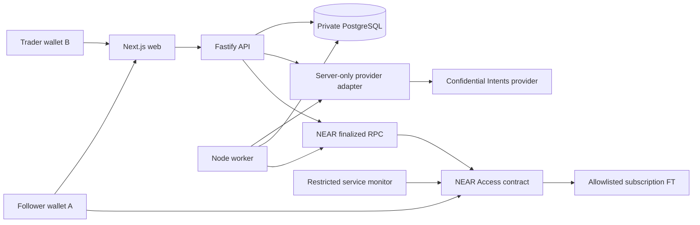

# Keyfolio architecture v1

Status: implementation contract for KF-00/KF-01/KF-02, 2026-11-06. No deployed components are implied. Product authority and amendments: decisions.md and baseline file 01.

Material product/infrastructure selection follows KF-D012 NEAR ecosystem first. [Capability matrix](capabilities.md) owns candidates, official sources, experiment outcomes and gaps; no extra integration is justified solely by ecosystem affiliation. Preserve existing scope/fund authority and keep documented capability separate from runtime acceptance.

## System boundaries

Arrows denote request/read paths, not funds custody. Wallets sign their own actions. API can prepare transactions/quotes; it cannot sign trading orders for users.

## Module contracts and ownership

| Module | Owns | Must not own |
|---|---|---|
| apps/web | Wallet UI, public/private screens, component primitives, user confirmation | Provider secrets, entitlement truth, payout calculations as authority |
| apps/api | Login/session/CSRF, credential policy, private request authorization, public projections, copy orchestration | Trading keys, fabricated live fallback, ledger mutation outside declared transactions |
| apps/worker | Fetch/normalize, cursor+events atomic persistence, reconciliation, valuations/snapshots, finalized NFT projection | Customer signing, uncontrolled payment execution |
| contracts/access | Plan terms, NFT owner/epoch/expiry, receipts, vesting, refunds, payout reservations/callbacks | Private account data, prices for performance, availability detection |
| packages/domain | Pure exact-amount/event/health/copy/performance rules | HTTP, database clients, process.env or UI |
| packages/provider-adapter | Internal capability interface and provider-specific mapping | Public exports of tokens; assumptions from undocumented endpoints |
| packages/api-contract | Browser-safe runtime request/response schemas and OpenAPI | Database rows, private provider payloads |

Cross-app source imports are forbidden. Apps consume domain/api-contract; only API and worker consume provider-adapter. Shared persistence code may be extracted when API/worker need an actual common implementation; do not duplicate schema ownership. One migration writer at a time.

## Account observation and performance

1. Prove authenticated source identity and store versioned consent.
2. Encrypt raw observations and record provenance/timestamps; normalize immutable economic events.
3. In one PostgreSQL transaction insert deduplicated events, apply ledger effects and advance the owned cursor. Retry after restart without applying effects twice.
4. Align balance boundaries and reconcile each atomic asset. Quarantine unknown movements; preserve pending effects separately.
5. Resolve event-time prices with provenance, compute equity/cash-flow-adjusted metrics only when complete.
6. Publish daily public aggregate projection at 00:00 UTC for the last complete valued day. Private data uses paginated API views.

Health dimensions are separate: access/auth state, observation freshness, schema validity, reconciliation/coverage and last-trade time. Idle activity does not reduce health. Persist outage evidence and distinguish disconnect, consent withdrawal and provider failure. See KF-D001.

## Authorization and NFT changes

Keyfolio login challenge is domain/network/account-bound and single-use. Provider authentication is a separate empty-intent ownership proof, with its own documented nonce/signing requirements. Never reuse the login signature as a provider or trading authorization.

Each private request checks credential/session, trader binding, NFT contract+network+token, current owner, expiry, epoch, scopes, source consent and shared license quota. Ownership observation older than 30 seconds triggers finalized refresh or denial. Pending transfer_call resolution denies access. Chain projection is a cache with freshness, never a replacement for final ownership. Transfer A->C->A cannot revive A's old credentials.

## Copy order boundary

Only a confirmed supported swap with trusted source economic time can enter copy eligibility; backfill observation time has no role in age. Adapter must return timestamp semantics/provenance, not merely a date-shaped string. API binds a fresh quote to follower, source trade, network, assets, exact input/minimum output, fees, slippage, deadline and controlled recipient/refund destinations. Follower signs; API stores idempotent order and recovers ambiguous submission before any retry. Submitted orders remain recoverable after NFT expiry.

## Subscription accounting

Contract retains unvested FT liabilities, separately from native storage deposits. Each purchase/renewal creates an immutable tranche. Reserve asynchronous payout before external FT call; private callback finalizes success or restores credit once. Service monitor may attest outage/consent withdrawal under policy, but cannot set payout recipient/amount or access trading funds. Financial termination cutoff is the block timestamp when the contract accepts the termination transaction (KF-D010), not the earlier outage start. Earnings/refunds freeze there; no automatic retroactive outage compensation or backdated unfunded refund. Public deployment awaits financial/auth acceptance and missing user authority.

## Environment and operational rules

Explicit FIXTURE, TESTNET, LIVE modes; no automatic fallback from live to fixtures. Chain identity always includes network. Amounts are canonical nonnegative integer strings at boundaries and bigint/widened integers internally. Persist UTC timestamptz off-chain and checked millisecond values on-chain.

Database is private, upstream tokens encrypted, API credentials hashed, raw payloads excluded from logs/evidence. Public HTTP deployment requires HTTPS and same-origin session routing or explicit trusted-origin policy. No hosting target is selected. Contract tests may use WSL/Linux if Windows sandbox binaries are unavailable.

## Initial integration gates

KF-00 executor proof precedes implementation delegation. KF-01 resolves account source access and timestamp/coverage semantics. KF-02 freezes wire schemas and initial migration together with domain types. KF-03 requires both KF-01 and KF-02 (the task-card detail refines the graph shorthand). UI composition waits for primitive states and authorization integration. Completion requires the baseline acceptance matrix, not a generated page or green unit suite.
