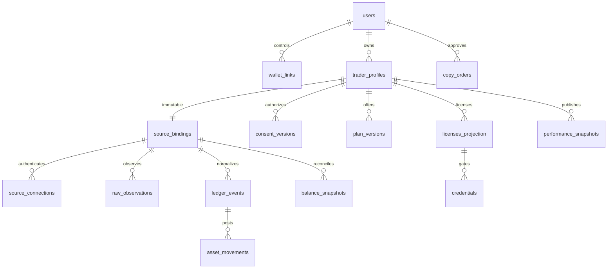

# Keyfolio persistence and chain placement v1

Status: logical design selected for KF-02 migration implementation; not an applied schema. PostgreSQL is the single off-chain transactional store. The access contract is financial/NFT authority. This document owns persistence design; product rules remain in baseline file 01 plus decisions.md.

## On-chain versus off-chain

| Data/rule | Canonical location | Reason / off-chain copy |
|---|---|---|
| Trader opaque ID, owner, service epoch, plan version/FT/atomic price/term/scopes | NEAR access contract | Public immutable purchase terms; API projects for discovery |
| NFT token ID, current owner, opaque binding ID, issue/expiry ms, epoch, disabled/pending transfer state | NEAR access contract | Transferable entitlement with observable authority |
| Purchase/renewal idempotency receipts and billing tranches | NEAR access contract | Prevent duplicate mint/billing and fund refunds |
| Vested/withdrawn credits, reserved payouts, refunds and callback action IDs | NEAR access contract | Financial invariants and asynchronous recovery |
| Native storage balances and FT allowlist/admin/monitor/pause rules | NEAR access contract | Enforce storage and restricted authority |
| Service termination cutoff and reason/epoch | NEAR access contract | Deterministic earnings/refund boundary; detection remains off-chain |
| Wallet login challenges, sessions, API credential hashes, quotas | Private PostgreSQL | Secret/session state and request policy; never on-chain |
| Source connection identity, encrypted provider tokens, consent/retention versions | Private PostgreSQL | Account privacy and authorization lifecycle |
| Raw observations, account balances, positions, trades, private source IDs | Private PostgreSQL/encrypted payloads | Confidential data must not leak through chain state |
| Ledger events/movements, reconciliation, historical prices, performance calculations | Private PostgreSQL | Reproducible off-chain accounting; not a proof system |
| Consented aggregate performance and public profile | PostgreSQL public projection/API | Publish only allowlisted aggregate fields, not base rows |
| Copy quotes/orders and provider receipts | Private PostgreSQL; settlement on route's network | Follower-only execution, status recovery and separate accounting |
| Monitor observations/outage intervals, audit events | Private PostgreSQL | Explain attestations without publishing trade payloads |

No provider secret, credential, wallet key, precise private holding, trade payload or raw source account address is written into NFT metadata. Opaque bindings are correlation identifiers, not anonymity guarantees. Subscription relationships remain public. No on-chain PnL/hash commitment is needed in v1; hashing private trades does not establish correctness or guarantee privacy.

## Logical relationships

## Tables and minimum constraints

| Table | Important fields | Constraints / authority |
|---|---|---|
| users | UUID id, created_at | App identity; not wallet signing authority |
| wallet_links | user_id, network, account_id, verified_at | Unique (network, account_id); real proof before linking |
| auth_challenges | id, nonce_hash, domain, network, account_id, issued/expires/consumed_at | Atomic single consumption; store no signing keys |
| sessions | id_hash, user_id, expires_at, revoked_at, csrf_hash | 15-minute session; private requests recheck entitlement |
| trader_profiles | id, owner_user_id, source_binding_id, display fields, publication/sales state | Unique immutable source_binding_id; new profile for replacement |
| source_bindings | id, provider, network, source_identity_hash, encrypted_identity, coverage_start | Immutable identity; unique provider/network/source identity policy |
| source_connections | binding_id, encrypted token envelope/key version, expiries, auth state, capabilities | Reauthentication preserves binding; only server decrypts |
| consent_versions | trader_id, version, four permission flags, accepted/withdrawn_at, policy_version | Append-only; disclosure decision derived from current consent |
| source_health_observations | binding_id, observed_at, access/validity/freshness facts, error_code | Last trade time separate; no trade-free outage inference |
| service_epochs | trader_id, chain epoch, outage_started_at, last_usable_at, monitor action refs | Off-chain observation is not confirmed chain termination |
| plan_versions | network, contract_id, trader_id, chain plan version, FT, atomic price, term/scopes | Immutable chain projection; composite unique identity |
| purchases | network, contract_id, purchase_id, payer, token_id, finalized receipt ref | Chain projection; unique payer/purchase ID in contract namespace |
| licenses_projection | network, contract_id, token_id, owner, epoch, expiry_ms, transfer state, block hash/height, observed_at | Composite unique chain token; stale rows cannot authorize |
| credentials | id, license identity, wallet, epoch, scope set, hash, created/expires/revoked_at | Secret shown once; max5/license; expiry <= license expiry |
| quota_windows | license identity, window_start, count/burst state | Atomic per-license increments shared by credentials |
| raw_observations | binding_id, fetch_id, received_at, schema version, encrypted payload/key version, expiry | Default purge at7d; never public or logs |
| ledger_events | provider, binding_id, source_event_id, revision, type/status, occurred/observed_at, trusted execution time/provenance, raw_ref, supersedes, normalization_version | Unique provider/binding/source_event/revision; immutable correction relation |
| asset_movements | event_id, movement_index, network/asset_id, signed atomic_delta, fee/boundary classification | Unique event/index; only confirmed effects; reverse corrections once |
| balance_snapshots + balance_items | binding_id, snapshot/time/boundary, asset_id, atomic amount, provenance | Aligned boundaries; exact per-asset reconciliation |
| reconciliation_runs | binding_id, boundaries, result, mismatch asset/atomic amount, version | Nonzero unexplained difference blocks complete metrics |
| price_observations | provider, network/asset_id, price_usd, effective_at, observed_at, provenance | Positive exact decimal, historical coverage explicit |
| performance_snapshots | trader_id, window_start/end, equity/PnL/return/drawdown nullable, coverage, reason, calculation version, ledger watermark | Unique deterministic window/version; no fake missing values |
| copy_orders | follower, source_event ref, idempotency_key, request_hash, quote binding/hash/deadline, state, execution ref | Unique follower/key; same key/different payload rejected |
| worker_cursors | binding_id, stream, cursor, lease/fencing version, updated_at | Unique binding/stream; transactionally committed with events |
| audit_events | actor, action, target opaque ref, timestamp, redacted outcome | Append-only metadata; no tokens or private trade payload |

Contract tranche/payout/refund views can be projected into additional read tables when their UI needs them; do not create an alternative spendable off-chain balance. Public subscriber count must be a deliberate aggregate, not a leaked subscriber list.

## Types, indices and transactions

Atomic FT values: PostgreSQL TEXT domain with canonical digit regex `^(0|[1-9][0-9]*)$`, length/range checks up to340282366920938463463374607431768211455. Compare39-digit values using C collation to the u128 maximum after length validation. Do not use NUMERIC(p,0) for input storage: it can round1.5 before a constraint runs. Direct database input1.5 and text'1.5' must fail the domain, as must overflow, signs, leading zeros and exponent notation. Check positive prices separately; zero is valid for balances. Signed deltas use a separate canonical signed-string domain with checked magnitude and no negative zero. Exact arithmetic may cast already validated strings to unconstrained NUMERIC within controlled queries; stored/API money remains strings. Rust/TS also enforce bounds and never coerce JSON numbers. Decimal USD prices and ratios require their own precision/rounding policy and are not atomic token fields.

Timestamps: timestamptz UTC for observations; nonnegative BIGINT checked ms for chain expiry. Persist source occurred/executed/confirmed time and local observed time independently. Add trust/semantic reason for copy timestamp. Network belongs in all asset, account, contract, token and receipt identities.

Indices: (binding, occurred_at, id) for stable activity pagination; (trader, window_end) for snapshots; (owner, network, contract) for licenses; (expires_at) for retention/jobs; unique event revision and idempotency indices above. API cursor is opaque and includes stable ordering boundary, not raw SQL offsets.

Transactions: cursor lease + raw/event insertion + ledger posting + checkpoint; nonce consumption + session issue; credential cap + insert; quota check+increment; copy key+payload reservation. External calls occur outside long transactions and are reconciled by durable operation IDs; never hold a DB transaction across wallet signing or FT promises.

## Security and retention

Separate migration, API and worker database roles; API public routes use allowlisted read models. No browser database access. Tokens/raw payloads use authenticated envelope encryption; encryption keys live outside DB. Credential secrets use keyed secure hashing with key-versioned rotation, never reversible encryption. Audit only metadata.

Raw payloads default7d encrypted retention. Private normalized history: active service plus30d after final license expires; purge trade payloads after that, retain minimal financial/audit obligations. Consent withdrawal stops disclosure immediately and follows termination policy. Production retention requires owner review. Backups are encrypted/private and restore is tested; implement purge/backup expiry consistently before paid launch.
